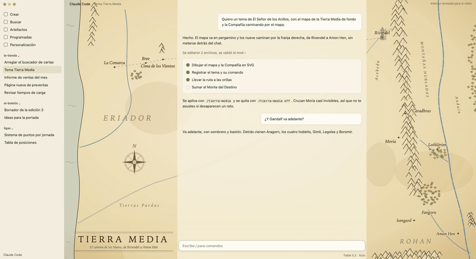

# Tierra Media

Un tema para Claude Code: un mapa de la Tierra Media dibujado en pergamino detrás del chat, con la Compañía caminando de Rivendel a Amon Hen por la orilla de la ventana.



[Ver el video completo (MP4, 16 s)](demo.mp4)

*El video es una recreación de la interfaz, con sesiones y conversación inventadas.*

## Qué hace

- Dibuja el mapa a los lados del chat: la Comarca, Bree y Eriador a la izquierda; las Montañas Nubladas, Moria, Lothlórien y el Anduin a la derecha.
- Nueve siluetas en fila recorren el camino y vuelven a empezar. Dentro de Moria se atenúan.
- Pone un velo claro sobre la columna del chat para que el texto se lea bien.
- Fuerza el modo claro mientras está activo.

Está pensado para la app de escritorio, con la ventana ancha y la barra lateral abierta. En la terminal no se dibuja nada.

## Instalar

En el prompt de una sesión de terminal:

```
/plugin install tierra-media --marketplace 12monkeys-happy/claude-tierra-media
```

Responde `y` para agregar el marketplace y elige el alcance con Enter.

Desde la shell:

```
claude plugin install tierra-media --marketplace 12monkeys-happy/claude-tierra-media
```

En la app de escritorio, donde `/plugin` no corre: clic en **+** junto a la caja de mensajes, luego **Plugins**, **Add marketplace** con `12monkeys-happy/claude-tierra-media`, y **Add plugin**.

## Usar

- `/tierra-media` muestra el mapa.
- `/tierra-media off` lo guarda.

Si tienes otro tema activo (por ejemplo uno de `theme-examples`), apágalo primero para que no le gane al mapa.

## Archivos

- `hooks/register.tsx`: el comando y el dibujo del fondo.
- `hooks/scene.ts`: el mapa, un solo SVG animado con CSS, sin scripts ni imágenes externas.

## Licencia

MIT. Ver `LICENSE`.

## Nota

Trabajo de fan, hecho por gusto. El dibujo es original; los nombres de lugares vienen de la obra de J. R. R. Tolkien. No está afiliado ni respaldado por Tolkien Estate ni por ningún titular de derechos.
